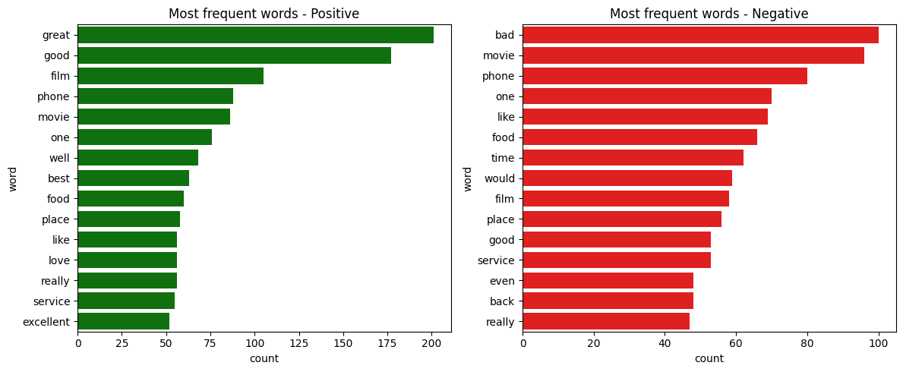

# Lab 01 – Sentiment Analysis Using Traditional Machine Learning

**Laboratory session:** Lab 1 – Sentiment analysis using traditional machine learning
**Notebook:** [`notebooks/Lab1_Sentiment_Analysis.ipynb`](notebooks/Lab1_Sentiment_Analysis.ipynb) (run on Google Colab, outputs saved)

## Objective

Practise basic NLP tasks: preprocess text, represent it as Bag-of-Words, and train and evaluate traditional machine-learning models that classify sentences as positive or negative.

**Dataset:** [UCI Sentiment Labelled Sentences](https://archive.ics.uci.edu/dataset/331/sentiment%2Blabelled%2Bsentences): 3,000 reviews from Amazon, IMDb and Yelp (1,500 positive, 1,500 negative)
**Libraries:** pandas, NLTK, scikit-learn, Matplotlib, Seaborn

## Tasks and Implementation

| Task | Implementation |
|---|---|
| 1. Load the dataset | Downloaded the zip and combined the three tab-separated files |
| 2. Preprocess the text | Lowercase, remove punctuation and other characters, collapse whitespace, store in `clean_text`, compare with the original |
| 3. Explore the data | Printed positive and negative examples; plotted the 15 most frequent words per class (NLTK stop words removed) |
| 4. Split the dataset | 80% train (2,400), 20% test (600), stratified, `random_state=42` |
| 5. Bag-of-Words | `CountVectorizer` fitted on the training set (vocabulary of 4,560 words) |
| 6. Train models | Logistic Regression and Linear SVM |
| 7. Evaluate | Accuracy, precision, recall and F1 on the test set |
| 8. Test new sentences | Four new sentences classified by both models |
| 9. Improving the model | TF-IDF, unigrams vs bigrams and the `C` value tuned with `GridSearchCV` (5-fold CV on the training set) |

## Results and Evidence

| Model | Accuracy | Precision | Recall | F1 |
|---|---|---|---|---|
| Logistic Regression | 0.823 | 0.809 | 0.847 | 0.827 |
| SVM | 0.813 | 0.790 | 0.853 | 0.821 |
| Tuned Logistic Regression (TF-IDF, `C=10`) | **0.828** | – | – | **0.834** |

| New sentence | Logistic Regression | SVM |
|---|---|---|
| This phone is amazing and the battery lasts all day | Positive | Positive |
| Worst service I have ever had | Negative | Negative |
| The movie was boring and too long | Negative | Negative |
| Great food and friendly staff | Positive | Positive |

## Observations

- Cleaning made words like *Great!* and *great* the same token.
- *great* and *good* are the most frequent positive words and *bad* the most frequent negative word, while topic words (*movie*, *phone*, *food*) appear in both classes. *good* also shows up in negative reviews, probably from "not good", since *not* is removed as a stop word.
- Logistic Regression did slightly better than SVM. For both models recall is higher than precision, so they lean slightly towards predicting positive.
- Tuning with TF-IDF and `C=10` gave a small gain (0.828 accuracy, 0.834 F1). Bigrams were not selected, probably because the dataset is too small for word pairs to repeat often.
- Both models classified all four new sentences correctly, but Bag-of-Words ignores word order, so negation and sarcasm can still be misclassified.
- *Challenges:* When I added the improvement step, the first run failed with a `NameError` because the `Pipeline`, `TfidfVectorizer` and `GridSearchCV` imports were missing, so I had to add them to the imports cell.

## Learning Outcomes

- I learned how to clean text and turn it into numbers with Bag-of-Words, and why the vectorizer must be fitted only on the training data.
- I understood what accuracy, precision, recall and F1 each tell me, and how to compare models with them.
- I saw that simple models already get around 82%, but they can't understand word order, negation or sarcasm.
