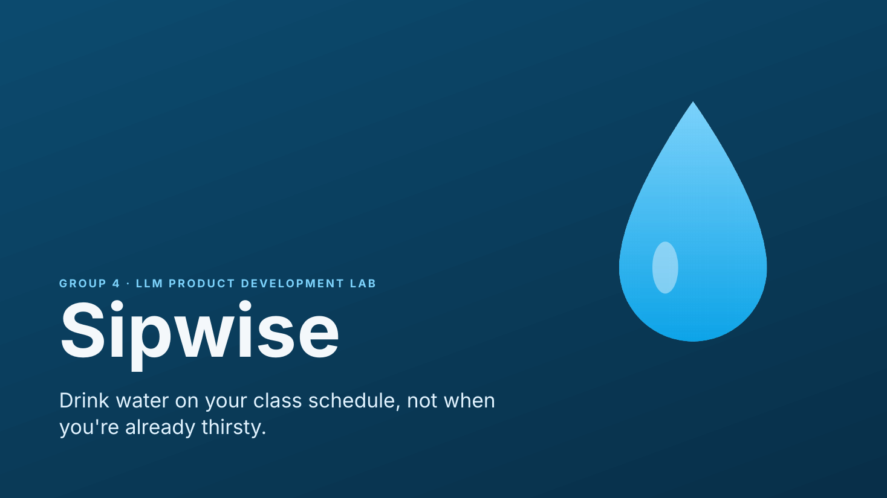
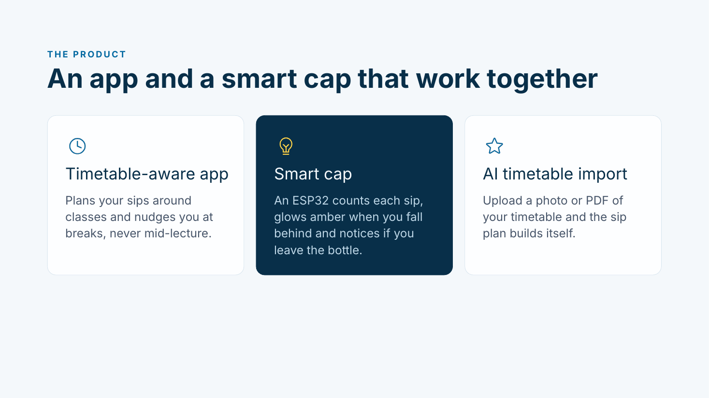
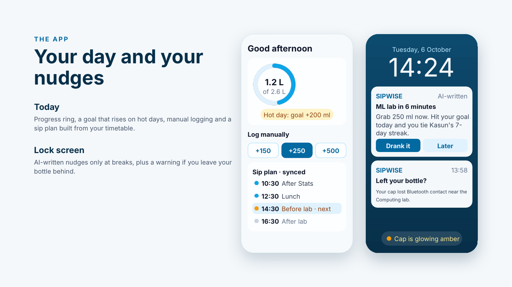
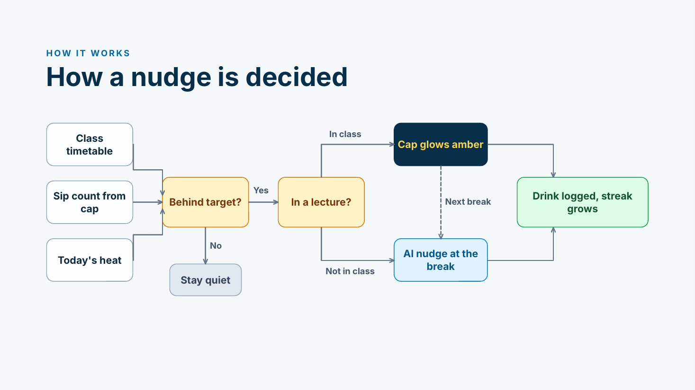
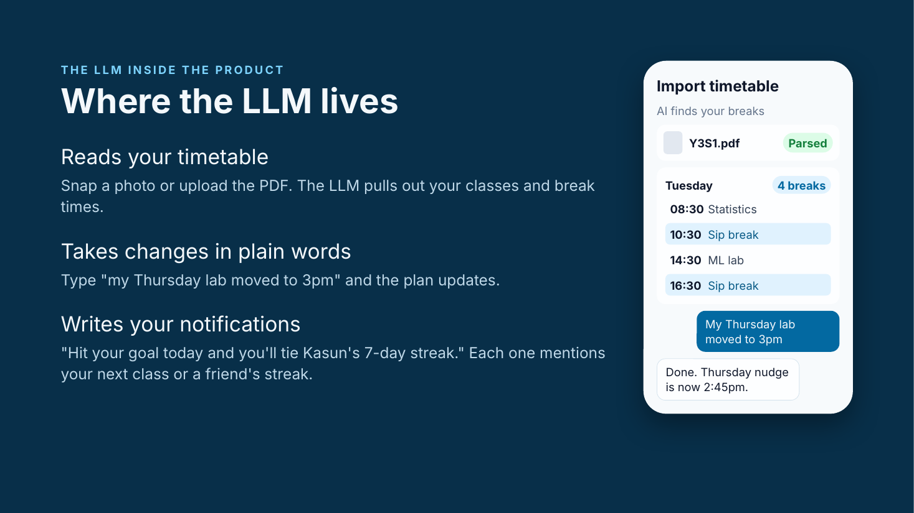
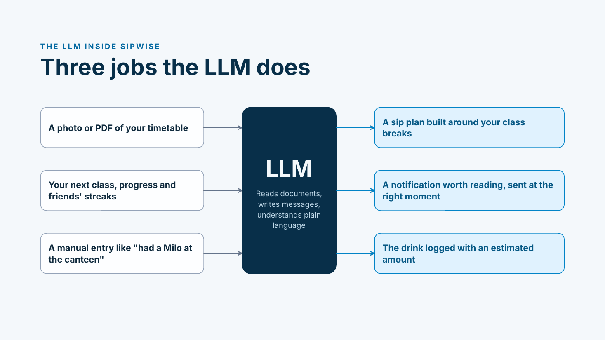

# Lab 02 – AI in Everyday Challenges

**Laboratory session:** Lab 2 – AI in everyday challenges (group activity)
**Group:** Group 4 – *The Dehydrated Student* (groups were assigned by the lecturer during the session)
**Product:** **Sipwise** – drink water on your class schedule, not when you're already thirsty

## Objective

Design and present an AI-powered solution to an everyday student problem as a group, practising critical thinking, problem solving and creativity, and applying AI to a real-world situation. Each group had to produce a product concept, name, key features, target user and a visual prototype or mock-up. The task was to present a solution, not to build it.

## The challenge (Group 4)

Students spend hours in lectures, labs and study sessions without realising they have barely had any water, and often drink only once they are already thirsty. Design a product that encourages better drinking habits throughout the day.

## Tasks and Implementation

1. **Understanding the problem.** Thirst is a late signal, and ordinary hourly reminder apps buzz in the middle of class, so students mute them.
2. **Defining the target user.** University students on packed timetables who already carry a bottle but forget to drink from it.
3. **Developing the concept.** Our group used **Claude** as a design partner while developing the idea. We first discussed a smartwatch-style device that tracks drinking, then agreed on a phone app with a smart bottle cap as the best fit for this specific problem (see the [discussion summary](group-activity/discussion-summary.md)).
4. **Designing the product.** A timetable-aware phone app plus an ESP32 smart bottle cap.
5. **Building the mock-up.** App screens and hardware diagrams, presented as a pitch deck.

### The product

| Part | What it does |
|---|---|
| Timetable-aware app | Plans sips around class breaks and nudges only at breaks, never mid-lecture; progress ring; goal rises on hot days |
| ESP32 smart cap | Counts each bottle opening as a sip, glows amber when you fall behind, sends the count to the app |
| Left-behind alert | Bluetooth proximity warns you if you walk away without your bottle |
| Campus refill map | Nearest water point and its distance |
| Friends' streaks | A light social push from classmates |

### Where the LLM is used inside the product

1. **Reads your timetable** from a photo or PDF and builds a sip plan around your breaks.
2. **Understands changes in plain words**, e.g. "my Thursday lab moved to 3pm".
3. **Writes the notifications**, mentioning your next class, your progress or a friend's streak.
4. **Logs drinks typed in plain language**, e.g. "had a Milo at the canteen", with an estimated amount.

## Results and Evidence

- Pitch deck: [PDF](presentation/Sipwise_Group_4_Pitch.pdf) · [PowerPoint](presentation/Sipwise_Group_4_Pitch.pptx)
- Group activity records: [outcomes](group-activity/activity-outcomes.md) · [discussion](group-activity/discussion-summary.md)

## Observations

- The key insight was that normal reminder apps fail because they buzz in the middle of lectures and get muted, so we tied the nudges to class breaks instead of fixed times.
- Adding the smart cap meant sips are counted automatically, so students don't have to remember to log every drink.
- Thinking about where the LLM fits made the product stronger: it does the jobs that are hard with fixed rules, such as reading a timetable photo, understanding changes written in plain words and writing personal reminders.
- We first considered a smartwatch to track drinking, but it is expensive, not every student has one, and it can't actually tell when you drink. A smart cap on the bottle students already carry solves the real problem more directly.
- Using Claude as a design partner helped us explore and shape the idea faster, but the final decisions came from our group discussion about what students actually need.
- *Challenges:* The hardest part was agreeing on one solution, since the smartwatch idea was attractive at first and we had to compare it carefully against the problem's requirements before choosing the smart cap.

## Learning Outcomes

- I learned to use an LLM (Claude) as a design partner, while still judging its suggestions as a group.
- I learned to start from the user's real problem and requirements before choosing a solution.
- I realised the first idea is not always the best: comparing options as a group (smartwatch vs smart cap) led to a simpler, more practical product.
- I learned to think about where an LLM really adds value inside a product, such as reading timetables and writing notifications.
- I practised working in a team and presenting a product pitch.
