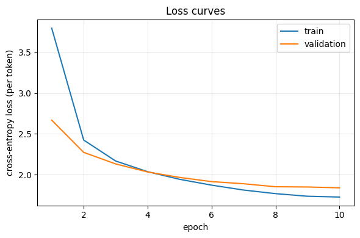
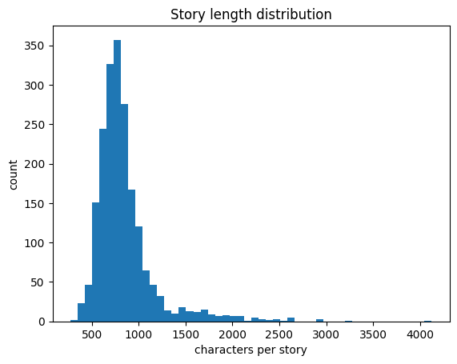
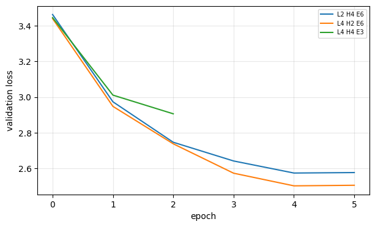

# Lab 03 – Developing a Tiny Transformer Language Model

**Laboratory session:** Lab 3 – Developing a Tiny Transformer Language Model
**Notebook:** [`notebooks/tiny_transformer_lab3_v2_bpe.ipynb`](notebooks/tiny_transformer_lab3_v2_bpe.ipynb)

## Objective

Build a small GPT-style (decoder-only) Transformer from scratch in PyTorch, train it on the TinyStories dataset for next-token prediction, evaluate it with validation loss and perplexity, and use it to generate short stories. Then vary the number of layers, attention heads and epochs to see how each affects the results.

## Tasks and Implementation (mapped to the lab sheet)

| Lab sheet step | Where it is done |
|---|---|
| 1. Load the dataset | Loads `roneneldan/TinyStories`, shows sample stories and the length distribution |
| 2. Preprocess the text | Trains a 4,096-token BPE tokenizer (v1 used character-level tokens) |
| 3. Prepare training data | Input/target blocks shifted by one token for next-token prediction |
| 4. Build the Transformer | Token + positional embeddings, masked multi-head self-attention, feed-forward, residuals, LayerNorm |
| 5. Initialise the model | 12.32M parameters, AdamW, cross-entropy loss |
| 6. Train the model | 10 epochs x 600 steps on a Colab T4 with fp16 |
| 7. Monitor training | Train/validation loss recorded and plotted each epoch |
| 8. Evaluate | Validation loss and perplexity |
| 9. Generate stories | Prompt "Once upon a time" with temperature / top-k / top-p sampling |
| 10. Experiment with settings | Depth, heads and epochs compared (table and chart below) |
| 11. Save the model | Weights, config and tokenizer saved |
| Optional: chat window | Gradio demo in the final cell |

---

## Project overview

A GPT-style, decoder-only Transformer trained from scratch in PyTorch on the [TinyStories](https://huggingface.co/datasets/roneneldan/TinyStories) dataset. The model learns to generate short, simple children's stories one token at a time.

This is **v2** of PUSL 3205 Lab 3. It improves on a character-level baseline with a subword (BPE) tokenizer, more data, a larger model, mixed-precision training, a learning-rate schedule and nucleus (top-p) sampling.

## Highlights

- Custom **Byte-Pair Encoding tokenizer** (4,096-token vocabulary) trained on the corpus with Hugging Face `tokenizers`
- Transformer written from scratch: token and positional embeddings, masked multi-head self-attention, feed-forward blocks, residual connections and pre-LayerNorm
- **12.32M parameters** (6 layers, 6 heads, 384-dim embeddings, 256-token context)
- Fused attention (`F.scaled_dot_product_attention`) and **fp16 mixed precision**
- AdamW with OneCycle LR (warm-up and decay), gradient clipping and weight decay
- Text generation with temperature, top-k and top-p (nucleus) sampling
- Experiments on depth, number of heads and training length
- Interactive **Gradio** demo for story generation

## Dataset

| | |
|---|---|
| Source | `roneneldan/TinyStories` (2,119,719 train / 21,990 validation stories) |
| Subset used | First 50,000 training stories and 2,000 validation stories |
| Average story length | ~850 characters, ~166 words |
| Train / val tokens | 11,356,695 / 399,129 |
| Average characters per token | 3.99 |

An `<eos>` token marks the end of each story. Training uses next-token prediction: for a block of tokens `x = tokens[i : i+T]`, the target is `y = tokens[i+1 : i+T+1]`.

## Model Architecture

| Setting | Value |
|---|---|
| Vocabulary size | 4,096 (BPE) |
| Context length (`block_size`) | 256 |
| Layers | 6 |
| Attention heads | 6 |
| Embedding size | 384 |
| Dropout | 0.1 |
| Parameters | 12.32M |

Design details:

- **Pre-LayerNorm** transformer blocks with two residual connections each
- **Weight tying** between the token embedding and output head
- **Scaled initialisation** of residual projections (`0.02 / sqrt(2 * n_layer)`) for stable deeper training
- **GELU** feed-forward layers with a 4x hidden expansion

## Training Setup

| Setting | Value |
|---|---|
| Epochs x steps | 10 x 600 (6,000 steps) |
| Batch size | 64 |
| Peak learning rate | 1e-3 (OneCycleLR, 5% warm-up) |
| Optimizer | AdamW (betas 0.9/0.95, weight decay 0.1) |
| Gradient clipping | 1.0 |
| Precision | fp16 autocast with GradScaler |
| Hardware | Google Colab T4 GPU (~16 min total) |

## Results and Evidence

Final model on the validation set:

| Metric | Value |
|---|---|
| Validation loss (per token) | 1.8333 |
| Perplexity (per token) | 6.25 |
| Validation loss (per character) | 0.4596 |
| Perplexity (per character) | 1.58 |

Per-character loss is computed as the per-token loss divided by the average characters per token, so it can be compared with the character-level baseline.

Validation loss fell steadily from 2.67 after epoch 1 to 1.84 after epoch 10, with train and validation loss staying close together (no significant overfitting).



Story length distribution of the subset used:



### Experiments

Three smaller configurations (`n_embd=256`, 250 steps per epoch) were compared:

| Layers | Heads | Epochs | Params | Val loss | Perplexity |
|:-:|:-:|:-:|--:|--:|--:|
| 2 | 4 | 6 | 2.69M | 2.577 | 13.16 |
| 4 | 2 | 6 | 4.27M | 2.506 | 12.26 |
| 4 | 4 | 3 | 4.27M | 2.906 | 18.29 |



Takeaways: more depth helped, and longer training clearly mattered (3 epochs vs 6). The full-size model, with more data and training steps, performs far better than any of these smaller runs.

### Sample output

Prompt: `Once upon a time`

> Once upon a time, there was a little girl named Lily. She had a favorite jacket that she loved to wear. One day, Lily's friend came over to play. Lily showed her jacket and said, "Look, Mommy! It's my favorite jacket!" ...

Sampling settings change the output noticeably: low temperature (0.5) gives safe, repetitive stories, while high temperature (1.1, top-p 1.0) produces more creative but less coherent text.

## Getting Started

### Requirements

- Python 3.9+
- A CUDA GPU is recommended (the notebook falls back to CPU, but training is slow)

```bash
pip install torch datasets tokenizers gradio matplotlib
```

### Run

1. Open `notebooks/tiny_transformer_lab3_v2_bpe.ipynb` in Google Colab (set the runtime to GPU) or Jupyter.
2. Run the cells in order. The notebook will:
   1. Download and explore TinyStories
   2. Train the BPE tokenizer and encode the corpus
   3. Build, train and evaluate the Transformer
   4. Generate sample stories and run the model-setting experiments
   5. Save the model and launch the Gradio demo

### Saved files

| File | Contents |
|---|---|
| `tiny_transformer_bpe.pt` | Model weights and config |
| `tokenizer.json` | Trained BPE tokenizer |


## Gradio Demo

The final cell launches a web interface where you can enter a story prompt and adjust temperature, top-p and maximum length. With `share=True`, Colab provides a temporary public link.

## What Improves Performance

- **BPE tokenization** puts capacity into grammar and story structure rather than spelling, and shortens sequences
- **Causal self-attention and multi-head attention** capture long-range dependencies such as a character's name several sentences earlier
- **Residual connections, pre-LayerNorm and scaled init** keep deeper models stable
- **More data and longer training** was the largest single factor over the baseline
- **AdamW, LR warm-up/decay, gradient clipping** give faster and more stable convergence
- **Mixed precision and fused attention** allow more training steps in the same time
- **Top-k and top-p sampling** balance diversity and coherence at generation time

## Limitations

- Trained on only 50,000 stories, so output is simple and sometimes repetitive or incoherent, especially at higher temperatures
- Small context window (256 tokens), so very long stories lose coherence
- Samples show occasional logical slips (e.g. objects that do not behave consistently)

## Observations

- Switching from character-level tokens (v1) to BPE (v2) and training on more data made the biggest difference to story quality.
- Train and validation loss stayed close, so the model was not overfitting at this size and data volume.
- In the experiments, the 4-layer models beat the 2-layer model, and cutting training from 6 to 3 epochs hurt far more than changing the number of heads.
- Sampling settings change the output a lot: low temperature gives repetitive but safe stories, high temperature gives more creative but less coherent ones.
- *Challenges:* My first version used character-level tokens and produced poor stories, so I had to switch to a BPE tokenizer. Training also had to fit within Colab's GPU time, which limited how many experiments I could run.

## Learning Outcomes

- I learned how a decoder-only Transformer works: token and positional embeddings, masked self-attention, feed-forward layers, residual connections and LayerNorm.
- I understood how a language model is trained to predict the next token, and how validation loss and perplexity measure it.
- I saw how much the tokenizer matters, since switching from characters to BPE improved the stories a lot.
- From the experiments, I learned that more layers and enough training epochs matter more than the number of attention heads.
- I learned how temperature, top-k and top-p change the generated text.

## Acknowledgements

- [TinyStories](https://huggingface.co/datasets/roneneldan/TinyStories) by Ronen Eldan and Yuanzhi Li
- Hugging Face `datasets` and `tokenizers`
- Coursework: PUSL 3205, Lab 3
