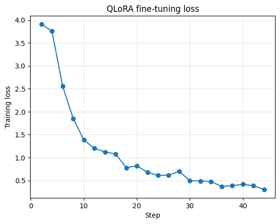

# Lab 04 - Fine-Tuning an LLM using LoRA / QLoRA

Lab 4 - Fine-tuning an LLM using LoRA/QLoRA
**Notebook:** [`notebooks/LoRA_QLoRA_Finetuning_Lab.ipynb`](notebooks/LoRA_QLoRA_Finetuning_Lab.ipynb) (run on Google Colab, outputs saved)

## Objective

Fine-tune a small instruction-tuned language model on a custom domain dataset using parameter-efficient fine-tuning (LoRA with 4-bit quantisation, i.e. QLoRA), then compare the original and fine-tuned models on the same questions, including questions that were not in the training data.

## Tasks and Implementation

| Lab sheet step | Implementation |
|---|---|
| 1. Install libraries | `transformers`, `datasets`, `peft`, `trl`, `accelerate`, `bitsandbytes` |
| 2. Check the GPU | Tesla T4, 14.6 GB VRAM (Google Colab) |
| 3. Choose a model | `Qwen/Qwen2.5-0.5B-Instruct` (≈0.5B parameters, instruction-tuned, has a chat template) |
| 4. Create a dataset | 34 Q&A pairs about a fictional computer shop, *PixelForge Computers* (hours, warranties, prices, services). Fictional facts mean the base model cannot already know them, so any correct answer must come from fine tuning. |
| 5. Configure LoRA / QLoRA | 4-bit NF4 quantisation with double quantisation; LoRA `r=16`, `lora_alpha=32`, `dropout=0.05`, adapters on all linear layers |
| 6. Supervised fine tuning | TRL `SFTTrainer`, 5 epochs, batch size 4, learning rate 2e-4, cosine schedule, fp16 |
| 7/8. Compare models | Same 8 questions to both models: 3 rephrased (topic trained, wording new), 3 unseen, 2 out of domain |

**Why a GPU:** training is mostly large matrix multiplications that a GPU runs in parallel, and the weights, activations and optimiser state must fit in GPU memory. That memory limit decides whether full fine tuning, LoRA or QLoRA is possible.

## Results and Evidence

### Training

| | |
|---|---|
| Base model memory (4-bit) | 430 MB |
| Trainable parameters | 8,798,208 of 502,830,976 (**1.75%**) |
| Training steps | 45 (5 epochs × 9 batches) |
| Training time | ~30 seconds |
| Training loss | 3.91 → 0.30 |
| Mean token accuracy (final) | 0.92 |

### Original vs fine-tuned answers

Answers shortened; full outputs are in the notebook. "Trained answer" is what the dataset says.

| Type | Question | Original model | Fine-tuned model | Trained answer |
|---|---|---|---|---|
| Rephrased | What time do you close on Saturdays? | Doesn't know it's a shop; lists closing times for Chinese cities | "Saturday closing is 17:00."  | 7:00 PM |
| Rephrased | If my graphics card dies after 2 years, is it still covered? | Generic explanation of warranties | "Yes … 36-month warranty from the date of purchase"  (but adds an irrelevant mention of Ryzen 5 / i9) | 36-month warranty |
| Rephrased | Can I pay for a laptop in installments? | Generic explanation of installment plans | "Install payments start from LKR 50,000 and end after six months."  six is right, threshold wrong | Above LKR 100,000, 6 interest-free installments |
| Unseen | Do you sell mechanical keyboards? | "As an AI, I can't sell products" | "Yes. We stock MSI, Logitech and Razer…"  invented | *(not in data)* |
| Unseen | Do you offer CCTV installation? | "As an AI, I can't install systems" | "LKR 7,000 to install a new camera, LKR 3,500 to replace one"  invented | *(not in data)* |
| Unseen | How much does it cost to replace a laptop keyboard? | Generic $50–200 estimate | Talks about RAM upgrade laptops from LKR 150,000  off-topic | *(not in data)* |
| Out of domain | What is the capital of France? | Paris  | Paris  | – |
| Out of domain | Explain what RAM is in one sentence. | Says RAM works "while the computer is turned off"  | "fast, temporary storage" but also says it works after the computer is turned off  | – |

## Observations

- **The style changed completely -** After only 45 steps the model answers as the shop, in short direct sentences, instead of long generic "As an AI…" answers.
- **Facts were only partly learned -** The graphics card warranty was correct, but the Saturday closing time was wrong and the installment answer mixed two facts (LKR 50,000 is actually the free-delivery threshold). The model picked up the *kind* of answer more reliably than the exact numbers.
- **Hallucination got worse on unseen questions -** The original model admitted it couldn't answer; the fine tuned model confidently invented products and prices (MSI/Logitech/Razer keyboards, CCTV installation prices). For a real shop this is the most dangerous failure, which is why RAG suits changing facts like prices better than fine-tuning.
- **No major catastrophic forgetting -** Both models still answered Paris. Both made the same mistake about RAM keeping data after power off, so fine tuning neither fixed nor caused it.
- **QLoRA made this cheap -** under 2% of parameters trained, a 430 MB base model, and about 30 seconds on a free T4.
- The final loss (0.30) with 34 examples and 5 epochs suggests the model is starting to memorise; there was no validation set to check this.
- Colab reported `bf16 supported: True` for the T4, but the T4 has no native bf16 hardware, so fp16 was still the right choice.
- *Challenges:* I got library version conflicts in Colab after installing the packages, and the trainer failed because of an fp16/bf16 data type mismatch, which I fixed by keeping the LoRA weights in fp32.

## Learning Outcomes

- I learned how LoRA trains small adapter matrices instead of the whole model, so only 1.75% of the parameters were updated.
- I understood how 4-bit quantisation (QLoRA) makes fine-tuning possible on a free GPU.
- I saw that fine tuning teaches style and format quickly, but exact facts less reliably.
- I learned that a fine-tuned model can confidently make up answers to questions it wasn't trained on, so RAG is better for facts that change.
