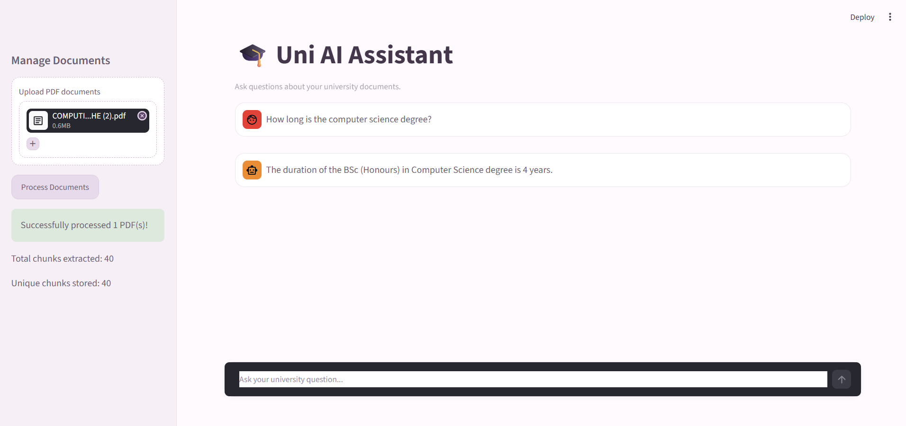
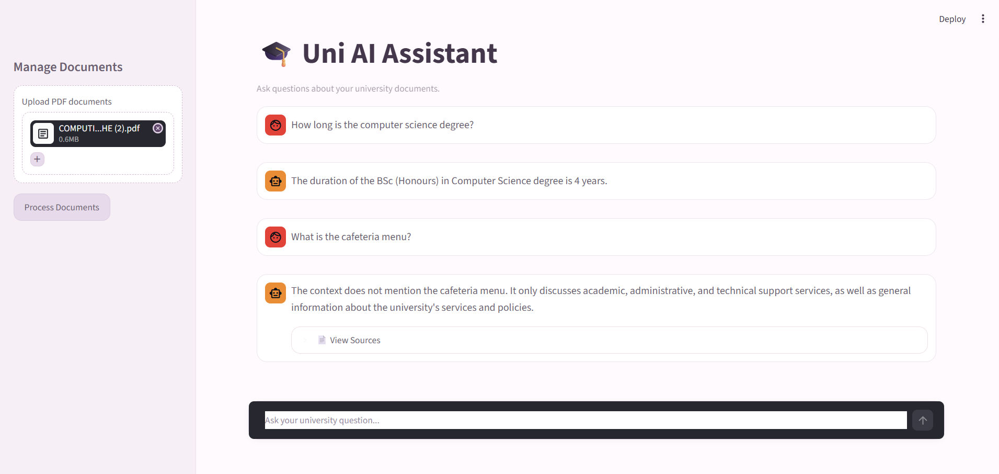
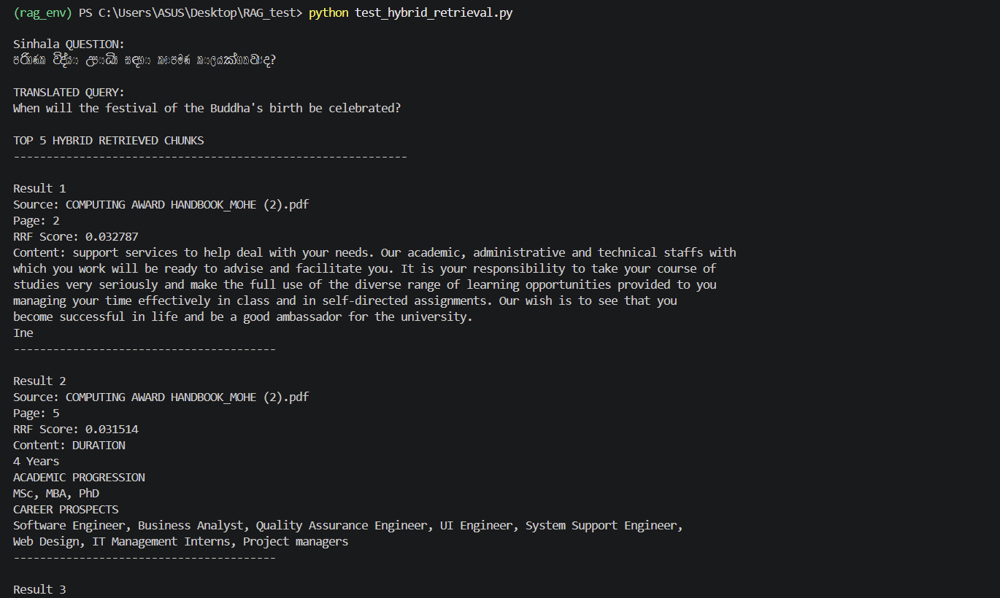
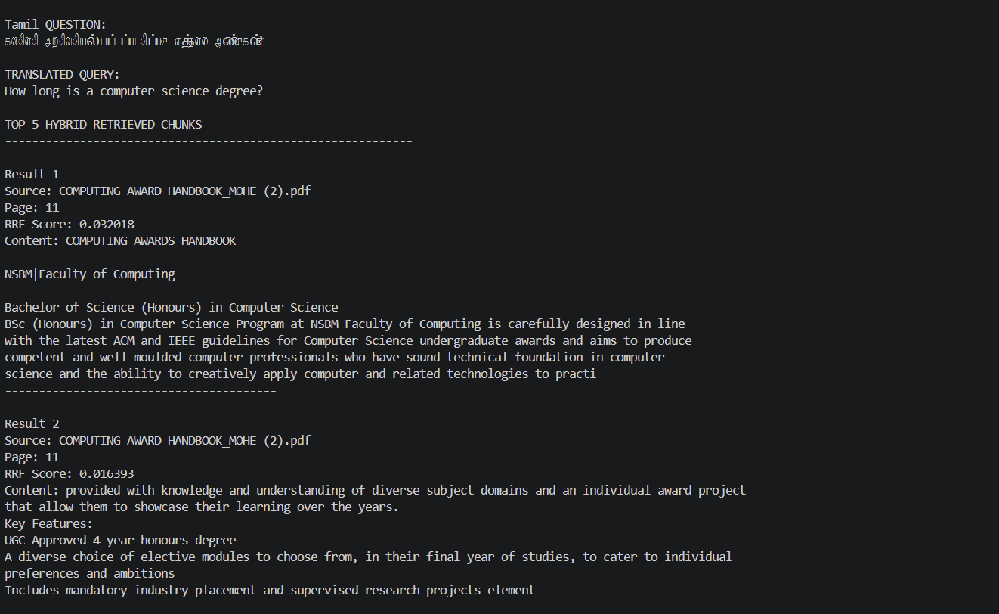

# Lab 05 - RAG Architecture (University Knowledge Assistant)

**Laboratory session -** Retrieval-Augmented Generation (RAG) architecture

## Objective

Build a local Retrieval-Augmented Generation system that answers questions about university documents using only the content of those documents. Then extend it so it can read several PDFs, let users upload their own PDFs in a chat window, and (as an extension) handle questions asked in Sinhala and Tamil.

## Stack

| Component | Choice |
|---|---|
| LLM | Llama 3.2 3B (via Ollama) |
| Embedding model | Qwen3 Embedding 0.6B (via Ollama) |
| Vector database | ChromaDB (persisted in `chroma_db/`) |
| Framework | LangChain (`langchain-ollama`, `langchain-chroma`, `langchain-community`) |
| PDF loading | PyMuPDF |
| Chat UI | Streamlit |

## Tasks and Implementation

### 1. Environment setup

```powershell
py -3.12 -m venv rag_env
.\rag_env\Scripts\Activate.ps1
pip install -r requirements.txt
ollama pull llama3.2:3b
ollama pull qwen3-embedding:0.6b
```

### 2. Ingestion – [`ingest.py`](ingest.py)

Loads every PDF in [`documents/`](documents/), splits it into 1,000-character chunks with 200 characters of overlap, embeds the chunks and stores them in ChromaDB.

### 3. RAG pipeline (terminal) – [`rag_pipeline.py`](rag_pipeline.py)

Retrieves the 4 most similar chunks for a question, puts them into a prompt that tells the model to answer **only** from that context (and to say so when the answer is not there), and prints the answer with its sources.

### 4. Chat window with PDF upload – [`app.py`](app.py)

Streamlit app (lab task: read more PDFs, let users upload their own):

- Upload one or more PDFs in the sidebar and click **Process Documents**
- Chat history, answers with an expandable **View Sources** list (file and page)
- **Duplicate prevention:** each PDF gets a SHA-256 fingerprint, and each chunk gets a stable ID built from the file hash, page and chunk text. Uploading the same PDF twice updates the existing chunks instead of adding copies.

### 5. Extension – multilingual questions ([`experiments/`](experiments/))

| Script | What it tests |
|---|---|
| `check_duplicates.py` | Counts duplicate chunks in the original `university_docs` collection (this is how the duplicate problem was found) |
| `check_clean_db.py`, `inspect_documents.py`, `inspect_key_pages.py` | Inspect what is stored in the cleaned `university_docs_clean` collection |
| `test_retrieval.py` | Plain similarity search on English questions |
| `test_multilingual.py` | Whether the embedding model produces vectors for English, Sinhala and Tamil questions |
| `test_sinhala_translation.py` | Translating Sinhala questions to English with Llama 3.2 |
| `test_translation_retrieval.py` | Translate the question to English first, then retrieve |
| `test_hybrid_retrieval.py` | **Hybrid retrieval:** search with the original question *and* the English translation, then merge the two result lists with Reciprocal Rank Fusion (RRF) |

Run them from this folder, for example `python experiments/test_hybrid_retrieval.py`.

## How to run

```powershell
python ingest.py           # build the database from documents/
streamlit run app.py       # chat window
python rag_pipeline.py     # terminal version
```

`chroma_db/` is generated and not stored in git. Delete it and run `ingest.py` again to rebuild from scratch.

## Results and Evidence

**Uploading and processing the handbook:** 40 chunks extracted, 40 unique chunks stored (no duplicates).



**Answering from the document, and refusing when the answer isn't there:** "How long is the computer science degree?" was answered correctly (4 years). "What is the cafeteria menu?" was correctly answered as not mentioned in the documents.



**Multilingual hybrid retrieval (Sinhala and Tamil):**

| Question | Translated query | Result |
|---|---|---|
| Sinhala: how long is the computer science degree? | "When will the festival of the Buddha's birth be celebrated?"  mistranslated | The "DURATION – 4 Years" chunk was still retrieved as result 2 |
| Tamil: how long is the computer science degree? | "How long is a computer science degree?"  | Computer Science programme page retrieved first |




## Observations

- Uploading the same PDF more than once filled the original collection with duplicate chunks, so the same text came back several times in the top-4 results and crowded out other relevant chunks. Content-based IDs and a new `university_docs_clean` collection fixed this.
- The embedding model returns vectors for Sinhala and Tamil, but because the handbook is in English, translating the question to English first is a more dependable way to retrieve the right chunks.
- A plain translation prompt was not enough, the translation prompt had to be given the context (a question about a university degree, "how long" means length of study) to stop it from being translated as something unrelated, such as a timer or countdown.
- Hybrid retrieval with RRF combines the direct and translated searches, so a chunk that ranks well in both moves to the top.
- The Sinhala test showed why hybrid retrieval matters. Llama 3.2 translated the question completely wrongly, but because the original question was searched too, the chunk with the degree duration was still in the top results. The Tamil question was translated correctly.
- The app correctly said the cafeteria menu was not in the documents instead of making up an answer.
- *Challenges:* Uploading the same PDF several times filled the database with duplicate chunks, so I had to rebuild it with unique IDs. Translating Sinhala questions was also tricky, because without context the model translated some questions into the wrong meaning.

## Learning Outcomes

- I learned the full RAG pipeline including loading PDFs, chunking, embeddings, storing vectors in ChromaDB, retrieval and a grounded prompt.
- I understood how chunk size and overlap affect what gets retrieved.
- I saw that telling the model to answer only from the context reduces made up answers.
- I learned that duplicate chunks can push out useful results, and fixed it with content-based IDs.
- I learned how to handle Sinhala and Tamil questions by translating them first and combining searches with Reciprocal Rank Fusion.
